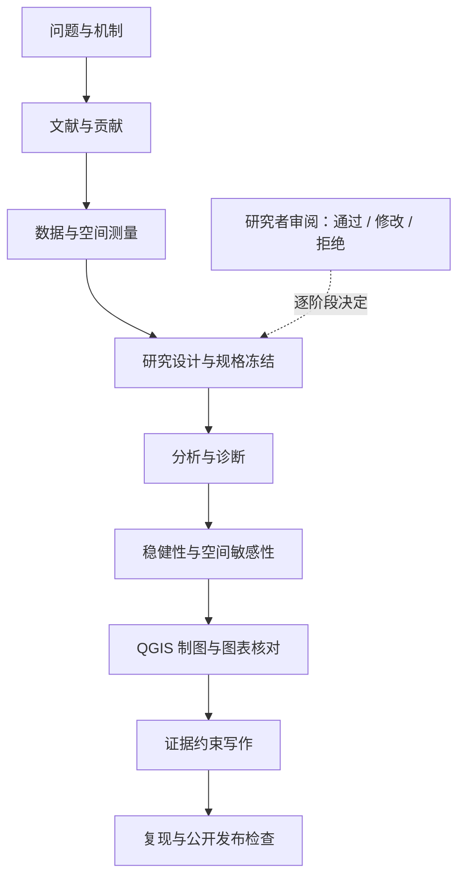

# Human Geography Research Agent

面向人文地理研究的证据驱动 Agent 工作流：从研究问题到可复现分析、QGIS 制图与论文写作。

**状态：开发预览。** 这是供编码 Agent 使用的技能包、阶段契约和 Python 工具，不是自动生成可信论文的服务。实际研究需要研究者判断。仓库仅包含虚构演示数据；不包含真实论文正文、样本、个人信息或既有项目代码。工作流提炼自目的地选择与共同作者复现两条英文研究路径；公开包不复现原论文数值，也不披露私有研究记录。

## 快速开始

需要 Python 3.10+，基础工具仅用标准库。

```bash
python scripts/workflow.py init --project work/my-study
python scripts/workflow.py status --project work/my-study
python scripts/prepare_demo.py --output work/demo
python -m unittest discover -s tests -v
```

将本仓库交给支持读取文件与执行脚本的 Agent：

> 读取 AGENTS.md 和 skills/human-geography-research/SKILL.md。以 work/my-study 为研究目录，先明确研究问题、空间单元、时间窗口和证据边界，从当前阶段继续；不要替我编造数据、文献或通过研究判断关卡。

也可把 `skills/human-geography-research/` 复制到你的 Agent 技能目录；技能本身提供完整流程说明，命令行工具仍需使用本仓库。

## 工作流



| 内容 | 入口 |
|---|---|
| 两条论文路径的流程提炼 | [研究路径](docs/research-pathways.md) |
| 阶段输入、产出和验收 | [研究工作流](skills/human-geography-research/references/workflow.md) |
| 流动、网络及其他人文地理设计 | [方法路由](skills/human-geography-research/references/methods.md) |
| QGIS 手工制图与 Python 自动化 | [制图流程](skills/human-geography-research/references/qgis.md) |
| 写作、证据和复现 | [写作流程](skills/human-geography-research/references/writing.md) |
| 表单与证据台账 | [templates](templates/) |
| 验证范围与限制 | [验证说明](docs/validation.md) |

## 实际执行边界

`workflow.py` 创建目录、检查阶段所需文件、记录文件哈希与研究者决定；不调用 LLM、不拟合模型、不判断科学质量。Agent 按技能执行具体研究任务。`prepare_demo.py` 生成虚构点与 OD 线，QGIS 脚本加载它们并输出项目、PNG、PDF。普通 Python 无法替代 PyQGIS 环境。

研究项目存放在被 Git 忽略的 `work/`；公开材料应逐项加入，不应整目录复制真实研究工作区。默认不下载在线底图、不自动投稿或发送邮件。
